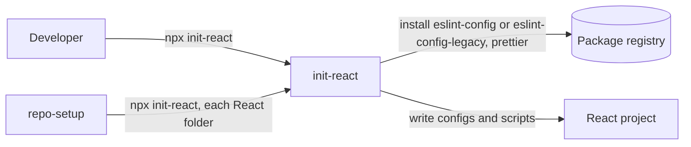

# `frontend-dev-config`

> The org's ESLint rules for React projects as npm packages, and `init-react`, a CLI that sets a
> React project up with them, Prettier, a `typecheck` script and release scripts.

|                |                                                                                                                               |
| -------------- | ----------------------------------------------------------------------------------------------------------------------------- |
| **Type**       | Library (npm packages) and CLI                                                                                                |
| **Use it as**  | npm packages `@janesenaj42/eslint-config`, `@janesenaj42/eslint-config-legacy`; CLI `npx @janesenaj42/init-react` |
| **Releases**   | Git tags `<package>@<version>`; each package's `CHANGELOG.md`                                                                 |

## Overview

Each package has its own version and release:

| Package                                 | For                                                              |
| --------------------------------------- | ---------------------------------------------------------------- |
| `@janesenaj42/eslint-config`        | Projects on ESLint 9 or 10 (`eslint.config.js`)                  |
| `@janesenaj42/eslint-config-legacy` | Projects still on ESLint 8 (`.eslintrc.json`)                    |
| `@janesenaj42/init-react`           | The CLI: picks the right ESLint package from your ESLint version |

Git hooks and commit checks are not here: repo-setup sets those up for every repository, and runs
`init-react` in each React folder.

**Use it when:**

- you have a TypeScript React project (Vite or similar) and want the org's ESLint and Prettier
  setup.

**Don't use it when:**

- you are setting up a whole repository: run repo-setup instead; it runs `init-react` for you.
- the project is Next.js, JavaScript-only or uses Bun: `init-react` stops with an error (see
  [Troubleshooting](#limitations-and-troubleshooting)).

---

## Quick start

**Requires:**

- Node.js 22.13 or later
- pnpm, optional: `init-react` installs with the tool the project's lockfile shows. A project with
  no lockfile gets pnpm if it is installed, npm otherwise. `npx` and `npm run` commands below work
  in pnpm projects too.
- A token for the package registry: GitHub Packages needs one even to install. On-prem, the
  Artifactory mirror's URL and token instead.

### Run it in a React project

1. Once per machine, create a GitHub token (classic) with `read:packages` and add it to
   `~/.npmrc`:

   ```ini
   //npm.pkg.github.com/:_authToken=YOUR_TOKEN
   @janesenaj42:registry=https://npm.pkg.github.com
   ```

2. In the folder with the React app's `package.json`:

   ```bash
   npx @janesenaj42/init-react --dry-run   # see what would change
   npx @janesenaj42/init-react             # apply it
   npm run format                              # once, so existing code matches
   ```

**Check it works:** `npm run lint` and `npm run typecheck` run, and `eslint.config.js` (or
`.eslintrc.json` on ESLint 8) extends `@janesenaj42/eslint-config`.

---

## Guides

### Update a project to the current rules

What to run in the project's folder depends on what was released:

| Release                                                         | Run                                                                                 |
| --------------------------------------------------------------- | ----------------------------------------------------------------------------------- |
| `@janesenaj42/eslint-config` 1.x: new or changed rules      | `pnpm update @janesenaj42/eslint-config` (or `npm update`), then `pnpm lint`    |
| `@janesenaj42/eslint-config` 2.0 or later                   | `npx @janesenaj42/init-react`: it moves the dependency to the new major version |
| `@janesenaj42/init-react`: scripts, ignore files, typecheck | `npx @janesenaj42/init-react`                                                   |

In a repository set up with repo-setup, run repo-setup at the root instead of init-react: it runs
init-react in each React folder.

The Standard's ESLint rules reach a project only if its ESLint config extends
`@janesenaj42/eslint-config`, and its Prettier settings only if it has no Prettier config of
its own. init-react keeps your own config and a file you have edited, and says so.

### Replace your own config with the Standard

1. See what would be replaced:

   ```bash
   npx @janesenaj42/init-react --dry-run --force=eslint,prettier
   ```

2. Replace it:

   ```bash
   npx @janesenaj42/init-react --force=eslint,prettier
   npm run format   # once: reformat the code with Prettier's defaults
   npm run lint     # fix what the Standard's rules report
   ```

   - `--force=eslint` writes the Standard's `eslint.config.js` (`.eslintrc.json` on ESLint 8).
     Add your own rules back where it says "Project-specific rules go here".
   - `--force=prettier` deletes your Prettier config (`.prettierrc*`, `prettier.config.*`), so
     Prettier's defaults apply.
   - `--force` with no list replaces every tool: `eslint`, `prettier`, `typecheck`, `release`.

### Install from the on-prem mirror

1. Run the CLI with the mirror's URL. It is saved in `package.json`, so later runs use it too:

   ```bash
   npx @janesenaj42/init-react --registry=<mirror-url>
   ```

### Change the rules for your project

Your config file extends the package; anything you write after it wins.

| Your config                       | Add or change a rule              | Turn a rule off | Leave out a whole part                                                                                                              |
| --------------------------------- | --------------------------------- | --------------- | ----------------------------------------------------------------------------------------------------------------------------------- |
| `eslint.config.js` (ESLint 9, 10) | In the object after `...standard` | `"off"`         | Import the parts you want instead of the default: `ignores`, `recommended`, `sonar`, `orgRules`, `reviewRules`, `tests`, `prettier` |
| `.eslintrc.json` (ESLint 8)       | In `"rules"`                      | `"off"`         | Extend the configs you want directly instead of the package                                                                         |

### Move from ESLint 8 to flat config

1. `npm install -D eslint@^10`
2. `npx @janesenaj42/init-react --force=eslint`: replaces `.eslintrc.json` with
   `eslint.config.js`. Add your own rules back where it says so.
3. `npm run lint`, and fix what the flat package's rules report.

### Make a release of your project

1. On the release branch (default `main`, set with `--release-branch`), with no uncommitted
   changes:

   ```bash
   npm run release:minor   # or release:patch, release:major
   git push --follow-tags origin main
   ```

2. On any other branch, make a prerelease instead: `npm run release:rc`, `release:beta` or
   `release:alpha`.

---

## Reference

### What `init-react` changes

Run `npx @janesenaj42/init-react --dry-run` to see the exact list for your project. A tool named
in `--skip` is left out.

| Tool        | Files written                                                                                                 | `package.json` changes                                                                                                                                                                                                                                    |
| ----------- | ------------------------------------------------------------------------------------------------------------- | --------------------------------------------------------------------------------------------------------------------------------------------------------------------------------------------------------------------------------------------------------- |
| Registry    | `.npmrc`: one line, `@janesenaj42:registry=<url>`, never a token. Yarn Berry: a warning to edit `.yarnrc.yml` | none                                                                                                                                                                                                                                                      |
| ESLint 9+   | `eslint.config.js` (`.mjs` if the project is not ESM) that spreads the Standard                               | devDependencies `eslint`, `@eslint/js`, `@janesenaj42/eslint-config`; script `lint` = `eslint .`                                                                                                                                                          |
| ESLint 8    | `.eslintrc.json` that extends the legacy Standard; deletes an unedited `eslint.config.*`                      | devDependencies `eslint`, `@janesenaj42/eslint-config-legacy`; script `lint` = `eslint --ext .js,.jsx,.ts,.tsx .`                                                                                                                                         |
| Prettier    | `.prettierignore` (`CHANGELOG.md` and lockfiles). No Prettier config: the Standard uses the defaults          | devDependency `prettier`; scripts `format` = `prettier --write .`, `format:check` = `prettier --check .`                                                                                                                                                  |
| Typecheck   | none                                                                                                          | script `typecheck` = `tsc --noEmit`, or `tsc -b` when `tsconfig.json` uses project references                                                                                                                                                             |
| Release     | none                                                                                                          | devDependency `@janesenaj42/init-react`; scripts `release:patch`, `:minor`, `:major`, `:alpha`, `:beta`, `:rc` = `init-react release <type>`; key `init-react` with `releaseBranch` (default `main`) and `tagPrefix` (`v`, or `<folder>@` in a subfolder) |
| Script docs | A `## Scripts` block listing the scripts above, in `CONTRIBUTING.md` if the project has one, else `README.md` | none                                                                                                                                                                                                                                                      |

`--skip` and `--registry` are saved under the `init-react` key in `package.json`, so later runs
reuse them.

What it leaves alone:

- Your own ESLint or Prettier config is kept, and the run says so. `--force=eslint,prettier`
  replaces it.
- A file it wrote starts with a `Managed by` line holding a hash. Edit the file and it becomes
  yours: later runs never touch it.
- An unedited Vite scaffold default it replaces (Vite's ESLint dependencies, `.oxlintrc.json`,
  the `oxlint` dependency) is deleted, and the run lists the deletion.

### CLI options

`npx @janesenaj42/init-react --help` prints these.

| Option                      | What it does                                                                                      |
| --------------------------- | ------------------------------------------------------------------------------------------------- |
| `--dry-run`                 | Show what would change; change nothing                                                            |
| `--force[=tools]`           | Replace your own config, for all tools or only some: `eslint`, `prettier`, `typecheck`, `release` |
| `--skip=<tools>`            | Leave these tools to something else; saved, so later runs skip them too. `--skip=none` clears it  |
| `--registry=<url>`          | Install the packages from this registry; saved. Default: `https://npm.pkg.github.com`             |
| `--release-branch=<branch>` | The branch full releases are made from (default: `main`)                                          |

---

## How it works



- `init-react` reads the project's ESLint version and installs `eslint-config` (ESLint 9, 10) or
  `eslint-config-legacy` (ESLint 8). A project without ESLint gets ESLint 10.
- The versions it installs are in `packages/init-react/src/constants.ts`.
- Decisions: [docs/adr](docs/adr). Terms: [CONTEXT.md](CONTEXT.md).

---

## Limitations and troubleshooting

**Known limitations**

- Only TypeScript React projects. Next.js, JavaScript-only and Bun projects are refused.

**Troubleshooting**

| Symptom                                           | Cause                                                     | Fix                                                           |
| ------------------------------------------------- | --------------------------------------------------------- | ------------------------------------------------------------- |
| `This is not a React project`                     | No `react` dependency in `package.json`                   | Run it in the folder with the React app's `package.json`      |
| `JavaScript-only projects are not supported`      | No `tsconfig.json` and no `typescript` dependency         | Add TypeScript first                                          |
| `! .prettierignore does not ignore CHANGELOG.md`  | `format:check` fails after a release                      | Add `CHANGELOG.md` to `.prettierignore`                       |
| `Full releases only happen on the Release Branch` | `release:patch`, `minor` or `major` run on another branch | Switch to the release branch, or make a prerelease            |
| `! Yarn Berry does not read .npmrc`               | Yarn 2+ reads the registry from `.yarnrc.yml`             | Add the `npmScopes` block the warning prints to `.yarnrc.yml` |

---

## Support and contributing

- **Questions and bugs:** open an issue in this repository.
- **Run it from source, release a package, or change it:** see [CONTRIBUTING.md](CONTRIBUTING.md)
